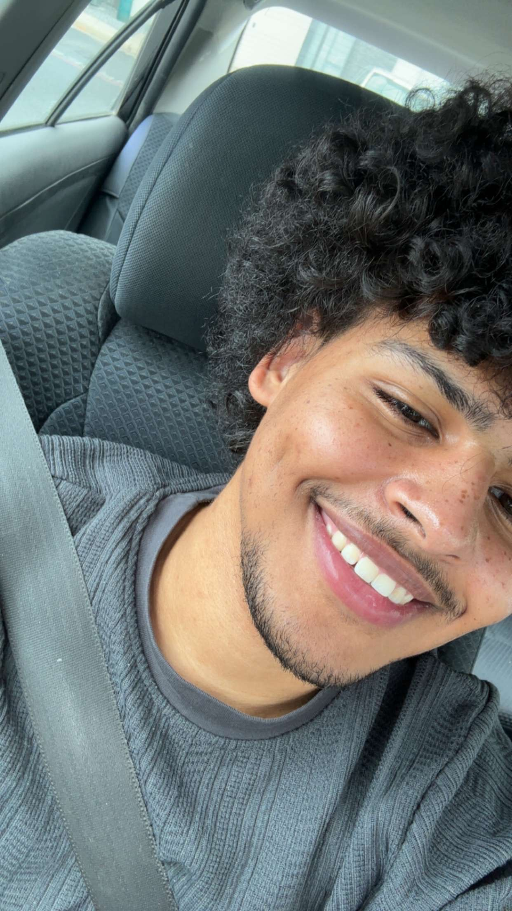

Hello, I’m Eddison, I’m an Engineering Student

Welcome to my GitHub profile.

about me

* I’m an Engineer student interested in tech
* I enjoyed python so I decided to take this class
* I’m working on learning Java and refreshing my coding skills since is been a year I took python.

* I’m also a huge baseball fan.

hobbies

* analyzing sports stats
* board and card games
* sport video games

contact

eap96963@email.vccs.edu

571-368-1474

Class Collaboration 

this is my contribution to our CSC 222 GitHub assignment.
